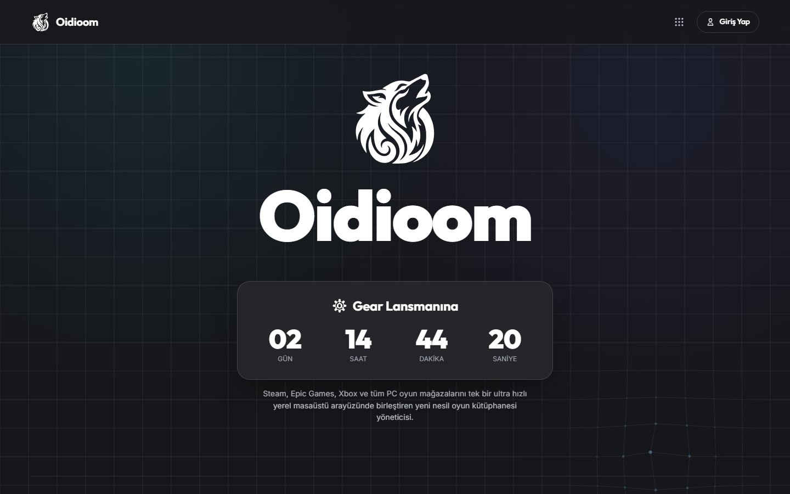
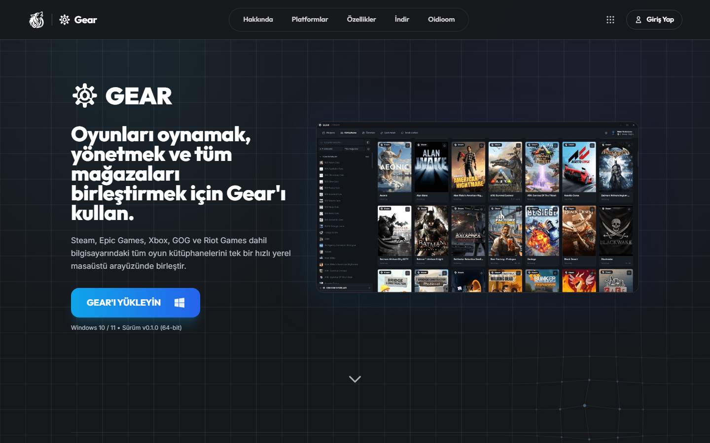
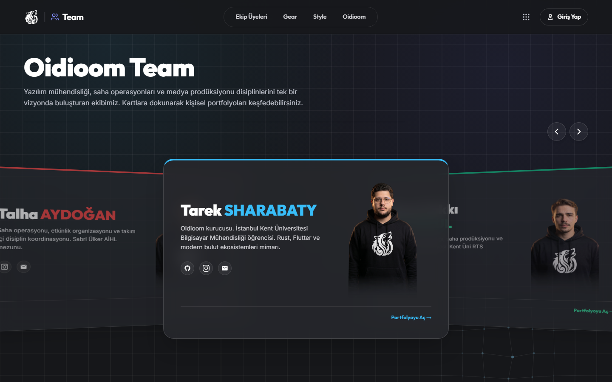
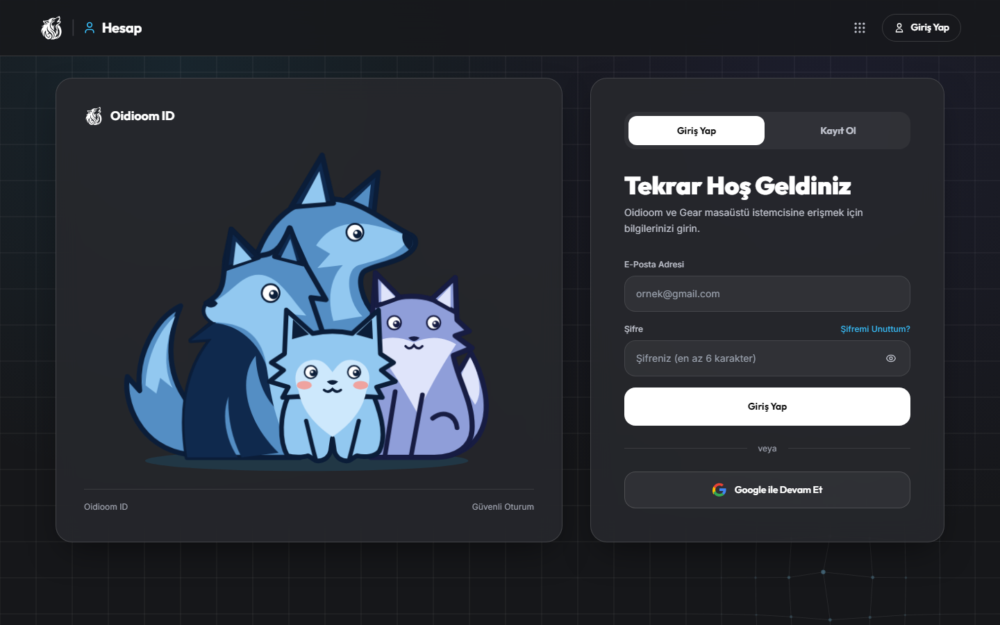
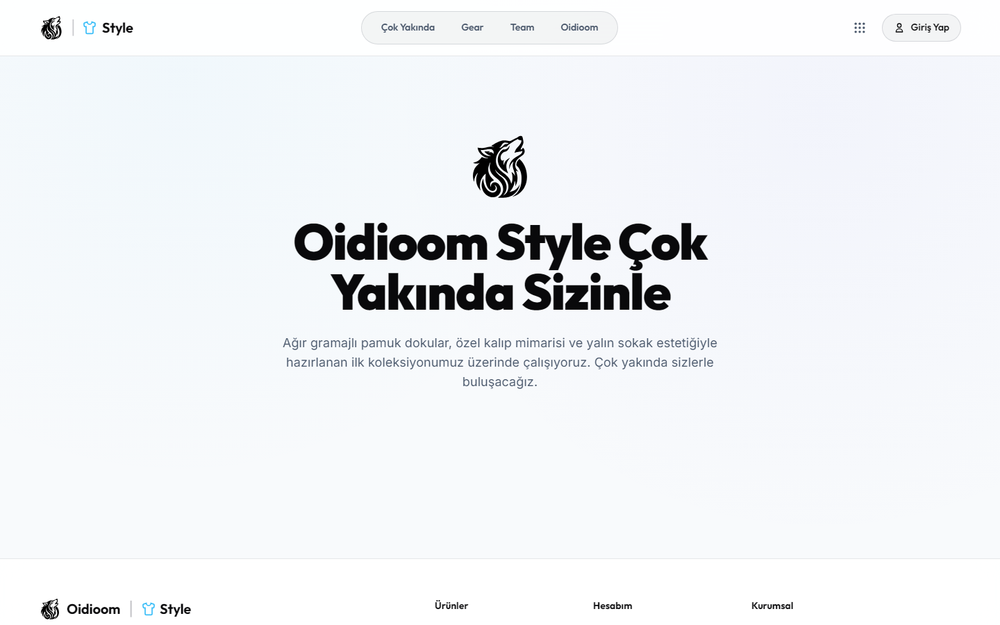
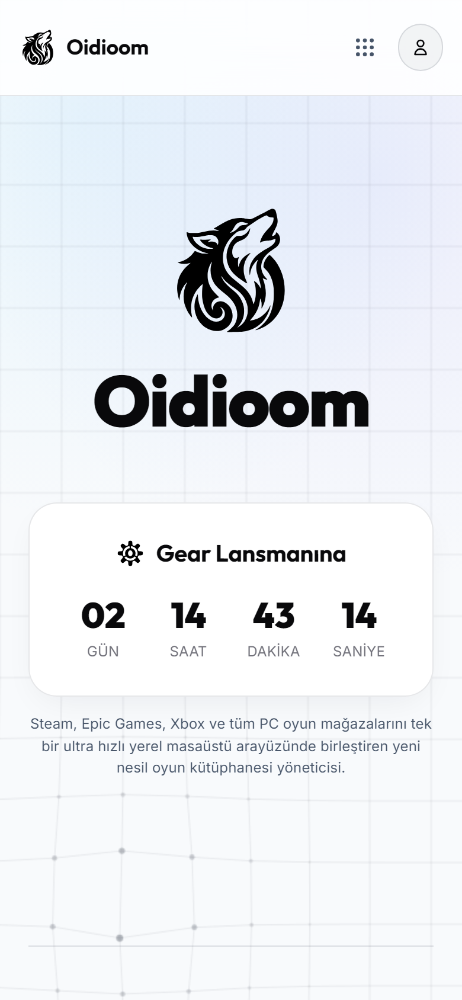

<p align="center"><a href="https://oidioom.com"><picture><source media="(prefers-color-scheme: dark)" srcset=".github/assets/oidioom-dark.svg"></picture></a></p>

<h1 align="center">🌐 oidioom.com</h1>

<p align="center"><b>The Oidioom ecosystem on the web — one account, many products.</b></p>

<p align="center">
  
  
  
  
  
  
  
  
  
  <a href="https://oidioom.com"></a>
  <a href="https://oidioom.com"></a>
</p>

<p align="center"><a href="#-english">🇬🇧 English</a> · <a href="#-türkçe">🇹🇷 Türkçe</a></p>

---

## 🇬🇧 English

oidioom.com is not a single page but a multi-site ecosystem: nine Firebase-hosted subdomains share one design system, one account and one session. It hosts the studio homepage, the Gear product & download page, a full account system with profiles and friends, an admin panel, the team & personal portfolios, the upcoming Oidioom Style store and all legal / KVKK pages.

> [!NOTE]
> This is a **showcase repository**. oidioom.com is closed-source; this repo contains the project overview, screenshots and a few short code excerpts.

## ✨ Features

- 🏠 **oidioom.com** — studio homepage with Gear launch countdown
- ⚙️ **gear.oidioom.com** — product page & Windows installer download
- 👤 **account / myaccount** — sign-up, sign-in, password flow, profile, friends, linked accounts and Gear device pairing
- 🛡️ **admin.oidioom.com** — user & role management
- 👥 **team.oidioom.com** + **tarek.oidioom.com** — team showcase and personal portfolios
- 👕 **style.oidioom.com** — Oidioom Style apparel store (coming soon)
- 📜 **policies.oidioom.com** — privacy, terms and KVKK/GDPR pages with a cookie-consent manager
- 🔁 Cross-subdomain single sign-on, shared header/footer and 9-dot app hub
- 🎮 Steam OpenID verification via a Cloudflare Worker
- 🧪 Unit tests (node --test), Firestore rules tests and Playwright e2e smoke tests

## 📸 Screenshots

<table>
<tr><td align="center"><br><sub>oidioom.com</sub></td><td align="center"><br><sub>gear.oidioom.com</sub></td></tr>
<tr><td align="center"><br><sub>team.oidioom.com</sub></td><td align="center"><br><sub>account.oidioom.com</sub></td></tr>
<tr><td align="center"><br><sub>style.oidioom.com</sub></td><td align="center"><br><sub>Mobile</sub></td></tr>
</table>

## 🧩 Code Showcase

A few real, short excerpts from the codebase — each with a note on what it does and where it is used. See the [`showcase/`](showcase) folder.

**[`escape_html.js`](showcase/escape_html.js)** — Escapes user-provided text before it is rendered into the page (XSS protection). _Used by every page that shows usernames, bios or other user data._

```javascript
function escapeHtml(str) {
  if (str == null) return '';
  return String(str)
    .replace(/&/g, '&amp;')
    .replace(/</g, '&lt;')
    .replace(/>/g, '&gt;')
    .replace(/"/g, '&quot;')
    .replace(/'/g, '&#039;');
}
```

**[`sanitize_url.js`](showcase/sanitize_url.js)** — Allows only safe URL schemes for links and images. _Used when rendering profile links and avatars._

```javascript
function sanitizeUrl(url) {
  if (!url || typeof url !== 'string') return '';
  const t = url.trim();
  const ok = ['https://', 'http://', 'data:image/', './', '../', '/'];
  return ok.some(p => t.startsWith(p)) ? escapeHtml(t) : '';
}
```

## 🛠️ Built With

HTML5 · Vanilla JS · Tailwind CSS · Firebase Hosting / Auth / Firestore / Storage · Cloudflare Workers · Playwright

## 📄 License

© 2026 Oidioom / Tarek Sharabaty. All rights reserved. See [LICENSE](LICENSE).

---

## 🇹🇷 Türkçe

**Oidioom ekosisteminin web yüzü — tek hesap, birçok ürün.**

oidioom.com tek bir sayfa değil, çok siteli bir ekosistemdir: Firebase üzerinde barınan dokuz alt alan adı tek bir tasarım sistemini, tek hesabı ve tek oturumu paylaşır. Stüdyo ana sayfası, Gear ürün ve indirme sayfası, profil ve arkadaşlık özellikli tam bir hesap sistemi, yönetim paneli, ekip ve kişisel portfolyolar, yakında açılacak Oidioom Style mağazası ve tüm yasal / KVKK sayfaları burada yer alır.

> [!NOTE]
> Bu bir **vitrin (showcase) deposudur**. oidioom.com kapalı kaynaklıdır; bu depoda proje tanıtımı, ekran görüntüleri ve birkaç kısa kod alıntısı bulunur.

## ✨ Özellikler

- 🏠 **oidioom.com** — Gear lansman geri sayımlı stüdyo ana sayfası
- ⚙️ **gear.oidioom.com** — ürün sayfası ve Windows kurulum dosyası indirme
- 👤 **account / myaccount** — kayıt, giriş, şifre akışı, profil, arkadaşlar, bağlı hesaplar ve Gear cihaz eşleştirme
- 🛡️ **admin.oidioom.com** — kullanıcı ve rol yönetimi
- 👥 **team.oidioom.com** + **tarek.oidioom.com** — ekip vitrini ve kişisel portfolyolar
- 👕 **style.oidioom.com** — Oidioom Style giyim mağazası (çok yakında)
- 📜 **policies.oidioom.com** — çerez tercih yöneticili gizlilik, kullanım koşulları ve KVKK/GDPR sayfaları
- 🔁 Alt alan adları arası tek oturum, ortak üst/alt bilgi ve 9 noktalı uygulama menüsü
- 🎮 Cloudflare Worker ile Steam OpenID doğrulaması
- 🧪 Birim testleri (node --test), Firestore kural testleri ve Playwright uçtan uca testleri

## 🧩 Kod Vitrini

Kod tabanından kısa ve gerçek alıntılar; kodlar yukarıdaki İngilizce bölümde gösterilmiştir. Hepsi [`showcase/`](showcase) klasöründe:

- **[`escape_html.js`](showcase/escape_html.js)** — Kullanıcıdan gelen metni sayfaya basmadan önce güvenli hale getirir (XSS koruması). _Kullanıcı adı, biyografi gibi kullanıcı verisi gösteren tüm sayfalarda kullanılır._

- **[`sanitize_url.js`](showcase/sanitize_url.js)** — Bağlantı ve görseller için yalnızca güvenli URL şemalarına izin verir. _Profil bağlantıları ve avatarlar gösterilirken kullanılır._

## 🛠️ Kullanılan Teknolojiler

HTML5 · Vanilla JS · Tailwind CSS · Firebase Hosting / Auth / Firestore / Storage · Cloudflare Workers · Playwright

## 📄 Lisans

© 2026 Oidioom / Tarek Sharabaty. Tüm hakları saklıdır. Ayrıntılar için [LICENSE](LICENSE).

---

<p align="center"><a href="https://oidioom.com"><picture><source media="(prefers-color-scheme: dark)" srcset=".github/assets/oidioom-dark.svg"></picture></a></p>
<p align="center"><b>by Oidioom — Tarek Sharabaty</b><br>
<a href="https://oidioom.com">oidioom.com</a> · <a href="https://github.com/tariksharabaty">GitHub</a> · <a href="https://modrinth.com/organization/oidioomstudio">Modrinth</a> · <a href="https://gear.oidioom.com">Gear</a> · <a href="https://www.instagram.com/oidioom">Instagram</a></p>
